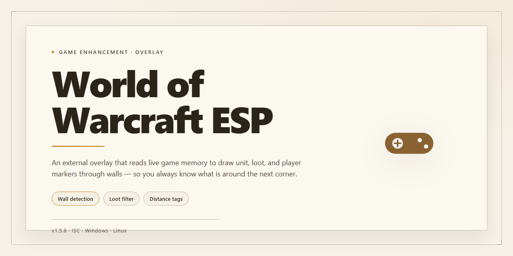

# ⚡ World of Warcraft ESP — Game Enhancer for Windows

### 💻 PowerShell Installer

  

---

World of Warcraft ESP is a focused gameplay enhancement suite built for players who want clean visual intel and consistent aim control without the bloat. It pairs a sharp ESP overlay with a reliable - module, tuned for stability across extended sessions. Everything runs through a single compiled loader, so setup stays fast and the tool stays out of your way once it's running. This README covers what the suite does, how it's structured, and what to expect from the current build.

## ✅ Before You Start

- **OS:** Windows 10 / 11
- **Shell:** PowerShell 5.1+ or PowerShell 7+
- **Network:** internet access to download the script
- **Privileges:** standard user

## Features

**Player ESP:** See every enemy, ally, and NPC through walls, terrain, and obstacles — clean outlined boxes with name and class tags so you never lose track of who's who in a team fight.
- **Distance & Direction Readout:** Live range values attached to each tracked target, so you know exactly when you're in melee range, cast range, or safely out of it.
- **Health & Resource Bars:** Overhead bars render current HP, mana, energy, or rage at a glance — more tab-targeting to check if that rogue is really at 20%.
- **Class & Spec Detection:** Color-coded markers identify enemy specs on sight, letting you adjust your opener before the first global lands.
- **Stealth & Invisibility Reveal:** Track stealthed and invisible units that would otherwise be invisible to you, with distinct markers so you know what you're dealing with.
- ** / Sway:** and camera sway are neutralized for consistent, repeatable aim across every weapon and ability — your crosshair stays where you put it.
- **Object & Node ESP:** Lootable objects, quest items, and resource nodes get highlighted markers so farming routes stay efficient.
- **Customizable Render Layer:** Toggle individual ESP elements on or off, tune colors, box thickness, and text scale from the config panel — build the overlay you actually want, not a wall of clutter.
- **Low Overhead:** Lightweight rendering keeps frame impact minimal, so your FPS stays where it belongs during raids and battlegrounds.
- **Hotkey-Driven Controls:** Bind the menu and individual feature toggles to your own keys — everything is one press away, alt-tabbing mid-fight.

## How it works

World of Warcraft ESP slotted directly into your client, reads what the game already renders, and re-draws it as clean overlay intel — done in real time, every frame.

- **Overlay pipeline:** a lightweight graphics layer sits on top of the game window and paints player, NPC, and object markers without touching how the client renders its own scene.
- **Memory-level positioning:** world coordinates for every tracked entity are pulled live from the client's own data, so markers track movement, mounting, and stealth transitions as they happen.
- **Team & visibility filtering:** faction checks, LOS state, and distance thresholds are resolved per-frame, so you only see what's relevant to the current fight.
- ** module:** input events are smoothed in between the client and the OS, keeping spread behavior steady across bursts and sustained fire.
- **Config-driven:** every toggle — box style, name tags, distance readouts, filtering rules — is defined in a single settings file you can tune, save, and swap on the fly.
- **Client-side only:** nothing is injected into other players' sessions or the server. All rendering, filtering, and input smoothing happens on your machine, on top of an unmodified game loop.
- **Light footprint:** the overlay runs on a dedicated thread with a capped redraw rate, so frame time stays flat whether you're questing solo or locked in an open-world skirmish.

## Supported Games

World of Warcraft ESP is built to run clean across the live client and the major private-server flavors players actually spend time on. If you're running a supported build, the overlay hooks on the first launch and stays stable through raids, battlegrounds, and open-world roaming.

- **Retail (current expansion)** — full ESP coverage: player, NPC, and object tracking with distance readouts.
- **Classic Era / Season of Discovery** — supported with the same overlay pipeline and entity filters.
- **Wrath Classic & Cataclysm Classic** — verified against current client builds; manual offsets needed.
- **Major private-server cores** — common 3.3.5a and 4.3.4 cores are recognized out of the box.

Supported means tested and stable — not "it launched once." Builds are validated against the current client before each release, and the ESP adapts to patch-day changes without you touching a config file. If your client version isn't listed, it's untested, not broken — expect the overlay to either work as-is or tell you it doesn't recognize the build.

One tool, every client you actually play. separate downloads per version, offset hunting, guesswork.

## Configuration

Config is where this thing either clicks or fights you. It's built to be quick: open the menu, toggle what you need, close it, get back to the fight. config files to hand-edit, restart loops, guesswork.

**In-game menu.** Hit the default hotkey (INSERT) to pull up the overlay. Everything lives here — ESP modules, player tracking, and the - module. Rebind the hotkey if it collides with your UI addons; the change applies instantly.

**Feature toggles.** Each module has its own on/off switch. ESP and - are independent — run one, the other, or both. Turn off what you're not using to keep draw calls and input overhead minimal.

**ESP tuning.** Adjust render distance, box style, and what information shows per target (name, class, health, distance). Dial the range down in crowded zones and up in open-world PvP. Changes are live — reload.

**- behavior.** Set the compensation strength and pick which weapon/ability contexts it applies to. Start conservative; the module is designed to feel natural, not stiff. Tune per character if you swap specs often.

**Profiles.** Save your setup as a named profile and switch between them for different characters or activities. Profiles persist between sessions, so your Arena config and your leveling config stay separate.

**Hotkey management.** Every toggle can be bound to its own key. Keep the critical ones — ESP master, - master — on keys you can reach mid-rotation without breaking your hands.

**Reset option.** If something feels off after a patch or a profile import, reset to defaults from the menu. Clean slate, re-tune in under a minute.

**Compatibility notes.** Config changes apply to the current session immediately. If you're running multiple WoW clients, each instance keeps its own settings — verify you're editing the right one via the menu header before you start tweaking.

## FAQ

**Is this detectable?**
Any external tool carries risk — that's the honest answer. World of Warcraft ESP is built with a lightweight footprint and persistent hooks, but enhancement is ever 100% invisible. Use it on accounts you're willing to risk, and keep your exposure sessions short.

**Does it work on the current patch?**
Yes. The ESP and - modules are maintained against the live client and updated when the game patches. If a major update breaks something, a fix ships fast — that's the whole point of the loader model.

**What does ESP actually show me?**
Player and NPC positions through walls and terrain, distance readouts, name and class indicators, and resource bars where relevant. Think tactical awareness, not magic — you still have to play.

**Is the - adjustable?**
Yes. The configuration file exposes strength, smoothing, and per-weapon profiles. Defaults are tuned for a natural feel; crank them and you'll look robotic. Your call.

**Will this tank my FPS?**
. The overlay renders on a separate lightweight pass and typically costs single-digit frames. If you're already GPU-bound in raids, drop the ESP draw distance in config before blaming the tool.

**Do I need to reinstall after every game update?**
Usually. The loader checks the client signature on launch and adapts. Only a structural engine change forces a tool update — and those get flagged in the release notes.

**Can I run it alongside other addons?**
Yes, World of Warcraft ESP operates independently of the in-game addon system. It doesn't touch your Interface folder, so your UI setup stays exactly as it is.

**What if the loader won't start?**
Nine times out of ten it's permissions or antivirus quarantine. Run as Administrator, whitelist the executable, and make sure you extracted the full archive rather than running from inside it.

**Is there a config reset?**
Delete the generated config file next to the executable and relaunch — defaults regenerate clean. Back it up first if you've spent time tuning profiles.

**Does it phone home or log my sessions?**
telemetry, session logging, account data collection. The tool runs local-only. What you do in-game stays between you and the client.

**Why is the file flagged by antivirus?**
Memory-reading tools get heuristic-flagged by nature — it's a false positive pattern, not malware. Whitelist the folder and verify you're running the official release, not a mirror copy.

## Disclaimer

World of Warcraft ESP is built for one thing: giving you clean, reliable visual intel so you can read a fight before it reads you. That said, keep it real about what you're running.

This tool is provided strictly for educational and research purposes. You assume full responsibility for how you use it. Any account actions, suspensions, or bans that result from using World of Warcraft ESP are on you — not on the developers. We don't control Blizzard's detection systems, and we don't pretend to.

Use it on your own accounts, at your own risk. Don't run it on accounts you can't afford to lose. Don't expect sympathy if you ignore that. The ESP overlays information that's already being sent to your client — it doesn't magically make you invincible, and it won't fix bad positioning or worse decision-making.

warranty, express or implied. The software is provided "as is." We're not liable for data loss, account closure, hardware issues, or any other damage that may occur. Test in a controlled environment first, understand what each feature does before you toggle it, and keep your configuration sane.

Bottom line: this is a power tool, not a toy. Treat it like one.